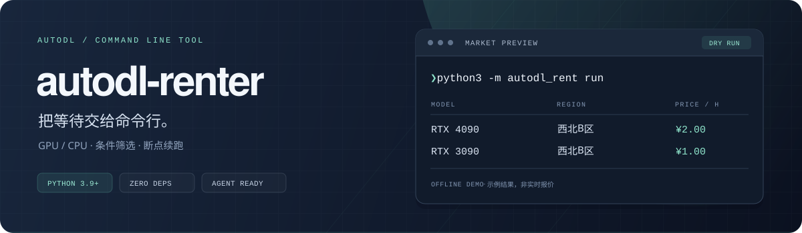

<p align="center">
  
</p>

<p align="center">
  <strong>已有 Python，下载源码就能用。</strong><br>
  扫码登录，按条件找算力，也能直接交给 Agent。
</p>

<p align="center">
  <a href="#快速开始"></a>
  <a href="#快速开始"></a>
  <a href="docs/agents.md"></a>
  <a href="LICENSE"></a>
</p>

<p align="center">
  <a href="https://github.com/J-shang/autodl-renter/archive/refs/heads/main.zip">下载源码</a> ·
  <a href="#快速开始">快速开始</a> ·
  <a href="#低价预设">低价预设</a> ·
  <a href="#交给-agent">交给 Agent</a> ·
  <a href="#文档">文档</a>
</p>

<br>

| 下载即用 | 按条件租用 | 任务可恢复 | Agent 友好 |
| :--- | :--- | :--- | :--- |
| Python 标准库实现，零依赖 | 地区、型号、数量、小时价格 | 保存进度，防止重复创建 | 非交互参数、JSON、操作 Skill |

## 快速开始

### 1. 下载，先体验一下

点击上方 **下载源码**，解压后进入项目目录；或者直接 clone：

```bash
git clone https://github.com/J-shang/autodl-renter.git
cd autodl-renter

# 离线演示：不登录、不联网、不产生费用
python3 -m autodl_rent demo
```

### 2. 登录、配置、预览

```bash
python3 -m autodl_rent login          # 微信扫码登录
python3 -m autodl_rent init           # 按提示选择资源、预算和镜像
python3 -m autodl_rent run            # 查看匹配结果
python3 -m autodl_rent run --execute  # 确认条件后，开始实际抢租
```

只需要 **Python 3.9+**，不用 pip 或虚拟环境。以下命令都在项目根目录执行；Windows 可将 `python3` 换成 `py -3` 或本机的 `python`。扫码微信需已关联 AutoDL 账号。

> **默认只预览。** `--execute` 才允许创建按量付费实例。停止工具不会关闭已创建的实例；小时价格上限也不是累计消费限额。

<details>
<summary><strong>多个目标，如何决定什么时候停止？</strong></summary>

| 策略 | 停止条件 | 例如 |
| :--- | :--- | :--- |
| `any` | 任意一个实例成功 | 4090 或 3090，抢到一个就行 |
| `all` | 每个目标都达到配额 | 4090、3090，各要一个 |
| `total` | 累计达到指定实例数 | 两种型号都可以，一共要三个 |

`init` 会引导选择策略。数量按**实例**计算，每个实例可以有多个 GPU 资源单位。详见 [配置与停止策略](docs/configuration.md)。

</details>

## 低价预设

**西北B区 · GPU / CPU 均可 · 严格低于 ¥1/时 · 成功一个即停**

登录后直接运行，自动选择基础 Miniconda 镜像，无需手写配置：

```bash
python3 -m autodl_rent quick            # 只预览
python3 -m autodl_rent quick --execute  # 租用一个单资源单位实例
```

任务使用 `config.west-under1.local.json` 保存条件和进度。再次运行会继续同一任务，已经成功则直接结束。查看进度：

```bash
python3 -m autodl_rent status --config config.west-under1.local.json
```

## 交给 Agent

把仓库目录交给支持运行命令的 Agent，告诉它：

> 请阅读这个项目的 AGENTS.md，帮我找西北B区的 RTX 4090，单卡、一个实例，每小时不超过 3 元。先预览库存，尚未授权实际租用。

[AGENTS.md](AGENTS.md) 会引导它使用非交互参数、结构化结果和恢复流程。无需安装 Skill 或 MCP 服务；支持 Skill 的客户端也可以直接读取仓库内的 [操作 Skill](autodl_rent/resources/autodl-renter/SKILL.md)。

```bash
python3 -m autodl_rent agent --json  # 发现命令、配置 Schema 和退出码
python3 -m autodl_rent demo --json   # 离线验证结果解析
```

更多提示词、扫码协作和错误处理见 **[Agent 使用指南 →](docs/agents.md)**

## 命令速查

<details>
<summary><strong>展开查看全部命令</strong></summary>

| 命令 | 用途 |
| :--- | :--- |
| `login` / `auth` | 扫码登录，或隐藏输入网页登录 Token |
| `init` | 交互配置；`--template` 离线生成模板，也支持完整参数 |
| `catalog regions / gpus / images` | 查询实时地区、型号、基础镜像 |
| `validate` | 离线校验任务；`--online` 加做只读联网检查 |
| `run` / `quick` | 默认预览；`--execute` 实际租用，`--once` 仅扫描一轮 |
| `status` / `resolve` | 查看进度，核对未知创建结果 |
| `doctor` | 本机诊断；`--online` 检查连接和登录 |
| `demo` | 离线体验三种停止策略 |
| `agent` | 查看操作协议、配置 Schema，或导出 Skill |

```bash
python3 -m autodl_rent --help
python3 -m autodl_rent run --help
```

`--config`、`--auth-file`、`--json` 和 `--non-interactive` 可以放在子命令前后。

</details>

## 文档

| 想了解什么 | 从这里开始 |
| :--- | :--- |
| 登录、运行、进度与异常恢复 | [使用与恢复](docs/usage.md) |
| 多目标、停止策略、预算与轮询 | [配置说明](docs/configuration.md) |
| 让 Agent 配置、预览和执行任务 | [Agent 使用指南](docs/agents.md) |
| 成功的定义、计费边界与接口来源 | [实现与接口依据](docs/implementation.md) |
| 认证、任务记录和分享范围 | [隐私与本地文件](docs/privacy.md) |
| 开发、测试与提交规范 | [贡献指南](CONTRIBUTING.md) |

<details>
<summary><strong>项目结构</strong></summary>

```text
autodl-renter/
├── autodl_rent/          Python 标准库实现：CLI、引导、API、筛选、任务状态
│   └── resources/       Agent 操作 Skill 与配置 JSON Schema
├── tests/               离线测试，不联网、不租用
├── docs/                用户、Agent、配置、实现与隐私说明
├── .github/workflows/   Linux / macOS / Windows 自动测试
├── AGENTS.md            Agent 进入仓库后的操作与开发说明
├── config.example.json  无账号信息的配置模板
└── .local/              本机认证、状态和日志（Git 忽略）
```

</details>

<details>
<summary><strong>本地文件与用后清理</strong></summary>

认证默认保存在 `.local/auth.json`，配置和状态也留在项目内。工具不往系统安装文件，用完可以删除源码目录。

已有任务请先处理完待核对请求，并保留所需的实例记录。**删除目录不会关闭或释放 AutoDL 实例，也不能用来处理未知的创建结果。** 具体位置和保护方式见 [隐私说明](docs/privacy.md)。

</details>

## 开发

测试同样不需要安装依赖：

```bash
python3 -m unittest discover -s tests -v
```

欢迎通过 Issue 报告问题，或提交改进。参与前请阅读 [贡献指南](CONTRIBUTING.md)。

---

<p align="center">
  个人维护的非官方工具，使用 AutoDL 普通算力市场网页接口。<br>
  <a href="LICENSE">MIT License</a> ·
  <a href="https://github.com/J-shang/autodl-renter/actions/workflows/ci.yml">跨平台 CI</a> ·
  <a href="https://github.com/J-shang/autodl-renter/issues">反馈问题</a>
</p>
